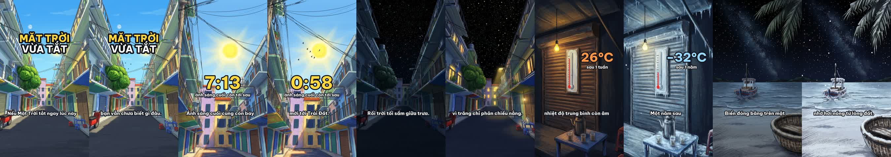

# claude-painted-3d-shorts

A Claude Code skill that makes vertical Shorts (20–30 s) in a "hand-painted 3D" look:

1. a voice track with word timings,
2. a simple Blender blockout of each place (built from code),
3. an image model (Google Flow) repaints each blockout still as a hand-painted background, then edits the same painting into its other states (day → night, dry → flooded),
4. the paintings are projected back onto the 3D set, so the camera can really move through them,
5. all motion (rain, snow, counters, gauges, cross-fades between states), captions, music and sound are done in code.

No characters act and no video model is used.

## Layout

- `painted-3d-short/SKILL.md` — the method, step by step, with the lessons learned.
- `painted-3d-short/tools/p3d.py` — Blender helpers: blockout parts, cameras, stills, projection renders.
- `painted-3d-short/tools/film.py` — cuts the rendered frames to the voice, draws captions and on-screen numbers, mixes audio.
- `painted-3d-short/tools/tts.mjs` — ElevenLabs voice with word times (`timing.json`).
- `painted-3d-short/tools/restyle.mjs` — sends the repaint jobs to Flow over several accounts at once.
- `painted-3d-short/example/` — the worked example "Nếu Mặt Trời tắt?" (scene, build script, Flow jobs, check sheet).

## Install

Copy `painted-3d-short/` into `~/.claude/skills/`.

## What you must bring yourself

The skill was written for one studio machine and is not standalone yet:

- **Blender 5.x** on the command line, **ffmpeg**, Python with Pillow and numpy.
- **An image model that can repaint a picture from a reference.** `restyle.mjs` imports a private Flow browser driver (`flow.mjs`, not in this repo). Replace it with your own call; it only needs "reference pictures + prompt → one picture".
- **ElevenLabs key** in `~/.config/elevenlabs/key` for `tts.mjs` (or write `timing.json` from any other voice tool).
- A font path in `film.py` (`FONT`), and the music / sound-effect / watermark helpers named in `SKILL.md` — these point at the studio's own scripts and absolute paths in `example/*.json` point at the original project folders.
